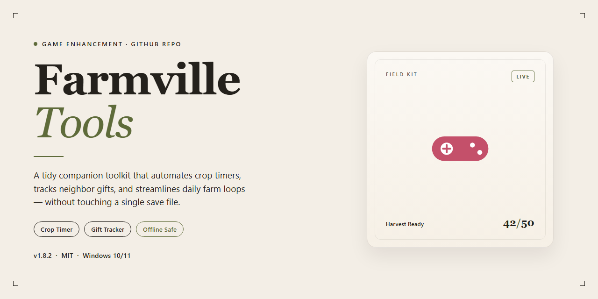

# 🚜 Farmville-Tools — Game Enhancer for Windows

### 🛠️ PowerShell Setup Button

    

---

Farmville-Tools strips the grind out of farm management on Windows, automating the harvesting and plowing loops that eat up your play sessions. It runs as a lightweight utility that handles routine crop work so your farm keeps producing even when you're not clicking. Download it free and let the tool do the busywork while you focus on the parts of the game that actually matter.

## 📋 System Requirements

- Windows 10 or Windows 11
- PowerShell 5.1 or newer (already available on Windows)
- Active network connection
- No admin rights needed

## Features

- **One-click automation** — Harvest, plow, and replant on command. No more clicking every tile by hand.
- **Smart scheduling** — Set your tasks to fire on timers, so your farm keeps running while you're away.
- **Custom action recording** — Record your own mouse movements and replay them as repeatable routines.
- **Zoom control** — Adjust farm zoom for a clean view of every plot and faster task targeting.
- **Simple, no-nonsense interface** — Everything is laid out plainly. Pick your task, hit start, and you're farming.
- **Full version unlocked** — Every feature is available from the first launch. No trials, no paywalls, no hidden costs.
- **Built for Windows** — Runs natively on Windows and slots right into your existing setup without friction.
- **Regular updates** — Performance fixes and feature improvements ship with every release to keep pace with the game.

## How It Works

Farmville-Tools runs as a lightweight Windows utility that sits alongside your game session and handles the grind for you. No convoluted setup, no scripting knowledge required — fire it up, point it at your farm, and let it work.

**Task Automation Engine**
The core of Farmville-Tools is its automation loop. You define what needs doing — harvesting ripe crops, plowing cleared plots, replanting seeds — and the tool executes those actions on your behalf. It reads the state of your farm and responds accordingly, so it's not just clicking blindly on a timer. When crops are ready, they get collected. When plots are empty, they get worked.

**Mouse Recording & Playback**
For actions that need a specific sequence, the recorder captures your mouse movements and replays them exactly as performed. Set up a routine once, save it, and trigger it whenever you need it. Custom paths, precise clicks, repeatable results.

**Scheduling & Hands-Free Operation**
Tasks don't run until you tell them to — or you can schedule them to fire automatically at set intervals. That means your farm keeps ticking over while you're doing something else. Wake up to harvested fields instead of withered crops.

**Farm Controls & Zoom Management**
Adjust farm zoom for a cleaner view of your plots, giving the automation a clearer read on what's ready and what isn't. Everything stays responsive and in your control.

**Lightweight by Design**
Farmville-Tools runs lean in the background. It doesn't hog resources, doesn't interfere with your game client, and doesn't require constant babysitting. Install it, configure your tasks, and get back to actually enjoying the game.

## Supported Games

Farmville-Tools is built for FarmVille on Facebook — that's the target, and it hits it clean. If you're running the classic FarmVille experience in a browser on Windows, this utility slots right in and starts automating your farm chores.

Here's the breakdown:

- **FarmVille (Facebook)** — the primary and fully supported game. Harvesting, plowing, and crop management automation all work against the live game as intended.
- **Browser-based play on Windows** — designed around the standard desktop browser setup, so no emulators or workarounds needed.
- **Classic farm management loop** — crop timers, field maintenance, and repetitive task scheduling are all covered.

One thing to be clear about: this is a FarmVille tool, not a universal farming-game swiss army knife. Other titles in the genre aren't supported, and the automation logic is tuned specifically to FarmVille's mechanics. If it's not FarmVille, don't expect it to work.

Bottom line — if FarmVille is your game and Windows is your platform, you're in the supported zone. Fire it up and let the farm run itself.

## Configuration

Farmville-Tools ships with sensible defaults, but the real power is in tuning it to your farm. Everything lives in the settings panel—no config files to hand-edit, no command-line flags to memorize. Open it, adjust, and get back to farming.

**Automation Settings**

- **Harvest & Plow Toggle** — Enable or disable each task independently. Run both for full maintenance, or plow-only when you're prepping new plots.
- **Action Interval** — Set the delay between automated actions. Lower values move faster; higher values keep things steady and low-profile. Tune it to your comfort level.
- **Task Priority** — Choose whether harvesting or plowing runs first when both are queued.

**Scheduling**

- **Auto-Start** — Kick off automation the moment the tool launches.
- **Timed Runs** — Schedule actions to fire at set intervals so your farm keeps ticking while you're away from the keyboard.
- **Session Limits** — Cap how long an automated run lasts before it stops itself.

**Farm Controls**

- **Zoom Adjustment** — Dial in the farm zoom level for reliable target detection. Set it once to match your window size and leave it.
- **Mouse Recording** — Record a custom sequence of movements and replay it on demand. Great for repetitive layouts that the default routines don't cover.

**Profiles & Persistence**

- Settings save automatically and reload on the next launch.
- Export your configuration to reuse across machines, or reset to defaults if you want a clean slate.

**Quick Tuning Tips**

- If actions miss their targets, nudge the zoom setting first—it's the usual culprit.
- Start with moderate intervals, confirm everything lands correctly, then tighten them.
- Pair scheduled runs with session limits so automation never overstays its welcome.

Default config works out of the box. Tweak only what your farm actually needs—the tool rewards a light touch.

## FAQ

**What exactly is Farmville-Tools?**

Farmville-Tools is a Windows utility built for FarmVille players who want their farm running on autopilot. It handles the grind — harvesting, plowing, replanting — so your crops keep cycling while you're doing literally anything else.

**Is it really free?**

Yes. Full version, all features unlocked, no paywall hiding the good stuff. Download it and everything works out of the box.

**How does the automation actually work?**

You set it up once: define your actions, record mouse movements if you want custom routines, and schedule when tasks fire off. Farmville-Tools takes it from there — harvesting and plowing on repeat without you babysitting the screen.

**Can I tweak it to match how I play?**

That's the point. Adjust zoom settings, build custom action sequences from recorded mouse movements, and set your own schedules. No rigid presets you're stuck with.

**Will it run on my machine?**

If you're on Windows 7, 8, 10, or 11 with 1 GB RAM and 100 MB of free disk space, you're good. Anything from the last decade clears that bar easily.

**Do I need to stay online?**

Only for updates. Once installed, the tool runs offline — your farm automation doesn't depend on a live connection.

**Is this safe to run?**

The installer is scanned and verified. Grab it from the official source and you're getting a clean, current build.

**Does it keep up with FarmVille changes?**

Yes. Updates ship with performance fixes and compatibility support for the latest FarmVille version, so the automation doesn't break when the game shifts.

**What do I get that a manual grind doesn't give me?**

Hours back. No more late-night harvest runs or clicking through plow cycles. Set your routines, let the tool work, and check in when you feel like it — your farm stays productive either way.

## Disclaimer

Farmville-Tools is a third-party utility built for automation and convenience. It is not affiliated with, endorsed by, or sponsored by Zynga, Facebook, or any official FarmVille entity. All game names, trademarks, and logos belong to their respective owners.

Automation tools interact with game clients and can violate a platform's terms of service. Using Farmville-Tools may put your account at risk, including warnings, suspensions, or permanent bans. You run this software entirely at your own discretion and accept full responsibility for any consequences that follow.

The tool is provided "as is," without warranties of any kind, express or implied. The developers make no guarantees about uptime, accuracy, compatibility with future game updates, or fitness for a particular purpose. Game mechanics and anti-automation systems change frequently, and features may break without notice.

Always download Farmville-Tools from the official source listed in this README. Builds obtained from unverified mirrors or repackaged installers are not supported and may contain modified or malicious code. Verify checksums where provided.

Back up your game data and system before first use. Test automation settings on a secondary account if you are unsure how they behave. Never share account credentials with any tool, and never run the software with elevated privileges it does not require.

By downloading, installing, or using Farmville-Tools, you acknowledge that you have read this disclaimer and agree to use the software responsibly and within the bounds of applicable law and platform rules.